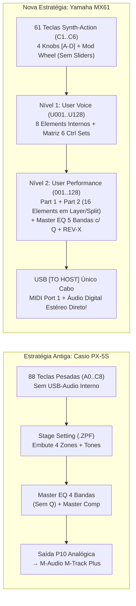

# ARC-001-ANL-v1.0 — Avaliação do Projeto `px5s` e Nova Estratégia de Engenharia Acústica & MIDI SysEx para o Yamaha MX61

> **Status**: Diagnóstico Arquitetural e Manuais Oficiais Concluídos  
> **Alvo de Hardware**: Yamaha MX61 (Motor AWM2 derivado do Motif XS — 166 MB Wave ROM, 8 Elements/Voice, 16 Parts/Performance, VCM + REV-X DSP, USB-MIDI & USB-Audio Integrados)  
> **Projeto Predecessor Avaliado**: `github.com/bchoelz/px5s` (Casio Privia PX-5S)

---

## 1. Manuais Oficiais do Yamaha MX61 Baixados no Repositório (`docs/`)

Todos os 4 documentos oficiais da Yamaha foram localizados nos servidores oficiais (`data.yamaha.com`), baixados e inspecionados integralmente na pasta `docs/`:

| Arquivo Local (`docs/`) | Título Oficial | Páginas | Conteúdo Técnico Essencial para o Projeto |
| :--- | :--- | :---: | :--- |
| `docs/mx49mx61_en_om_b0.pdf` | **MX49/MX61 Owner's Manual (Rev. B0)** | 48 | Operação de painel, controles físicos (`Knobs A–D`, `[PART 1-2 LINK]`, `[LAYER]`, `[SPLIT]`), conexões USB (`TO HOST` / `TO DEVICE`), salvamento de `.X5A` e atalhos `[SHIFT]`. |
| `docs/mx49mx61mx88_en_rm_b0.pdf` | **MX49/MX61/MX88 Reference Manual (Rev. B0)** | 71 | Arquitetura interna completa: blocos *Controller*, *Tone Generator (AWM2)*, *Effect Block* (`4x Insertion` + `Chorus` + `Reverb` + `Master EQ 5 bandas`), fluxo de sinal **USB-Audio Bidirecional (2-In/2-Out)**, portas USB-MIDI (`Port 1..5`), `Edit Buffer` vs. `Recall/Compare Buffer` e `User Memory`. |
| `docs/mx49mx61_en_dl_a0.pdf` | **MX49/MX61 Data List (Rev. A0)** | 69 | Catálogo das **1.106 Preset Voices** (ex.: `AP:001 CncrtGrand` a `AP:025 CP 2007`, `KB:001 Vintage'74` a `KB:064`), **61 Drum Kits**, **128 Performances**, **48 Effect Types + Tabelas de Parâmetros (#1 a #26)** e **Especificação Completa MIDI SysEx (`Model ID = 7F 17`, págs. 53–66)**. |
| `docs/mx49mx61synth_en_pm_a0.pdf` | **Synthesizer Parameter Manual (Rev. A0)** | 74 | Anatomia profunda do motor **AWM2 de 8 Elements por Voice**: `XA Control` (*eXpanded Articulation*: `Normal`, `Legato`, `Key Off Sound`, `Wave Cycle`, `Wave Random`, `AF1/AF2`), `Velocity Cross Fade`, filtros (`LPF24D`, `LPF24A`, `LPF18/18s`, `HPF`, `BPF`, `BEF`, `Dual LPF`), `Filter/Amplitude Scaling` de 4 Breakpoints (`BP1..BP4`), `PEG`/`FEG`/`AEG`, `Half Damper` e efeitos `VCM`/`REV-X`. |

---

## 2. Avaliação Técnica do Projeto `bchoelz/px5s` (O que Foi Desenvolvido e Como Funciona)

O projeto `px5s` resolveu o problema de timbragem do piano digital **Casio Privia PX-5S** através de uma suíte Python + C# estruturada em 6 pilares:

1. **Engenharia Reversa Binária (`.ZPF` / `.ZTN` / `.ZLT` em `src/zpf_codec.py`)**:
   - Extração das tabelas de bit-offset (`patch_bitmap.csv` com 8.615 campos) do executável `DataEditorPX5S.exe`.
   - Manipulação bit-a-bit da imagem de `11.612 bytes` + cálculo de `CRC32` IEEE 802.3 para destravar parâmetros ocultos inacessíveis no LCD do PX-5S (`Lid Simulator`, `KFF_GAIN=128` para desabafar as oitavas 4 e 5, `SYS_FX_SEND_OVERRIDE=0`) e embutir structs binárias de *Melody Tones* (`412 bytes`) e *Hex Layers* (`948 bytes`) nas 4 Zonas.
2. **Protocolo MIDI SysEx em Tempo Real (`F0 44 17 02` em `src/px5s_sysex.py`)**:
   - Implementação de `IPR`/`IPS` (edição individual em RAM com latência `< 10 ms`) e `OBR`/`OBS`/`HBR`/`HBS` (transferência Bulk empacotada 8-bit ↔ 7-bit) sem pendrive.
3. **Ponte Nativa USB-MIDI & USB-Audio (`src/winmm_bridge.cs` + `src/midi_bridge.py`)**:
   - Como o PX-5S não possuía interface de áudio USB interna, foi necessário capturar as saídas analógicas `LINE OUT L/R` via placa externa **M-Audio M-Track Plus** (`waveIn` 48 kHz / 16-bit estéreo) sincronizada ao envio MIDI (`midiOut`/`midiIn`).
4. **Governança de Slots, Proteção do Baseline (`0-0`) e Backup em 2 Camadas**:
   - Blindagem rígida do slot `0-0` (`GrPnoConcert` original) para comparações A/B imediatas.
   - `full-backup` imutável (`backups/full_initial/`) das 29 configurações globais (`CAT_SPEC`) e dos 100 Stage Settings, descoberta automática de slots livres (`"No Assign"`) via `scan-slots` e `restore-full-backup` sem depender de Factory Reset.
5. **Síntese Multi-Layer com Parcimônia (1 a 4 Zonas em `src/cfx_profiles.py`)**:
   - Empilhamento de Zonas (`Zone 1 Core AiR` + `Zone 2 Soundboard Body` + `Zone 3 Hammer/4ª-5ª Oitava` + `Zone 4 Rhodes/Strings` nos Sliders) para compensar as limitações da amostra nativa da Casio e a ausência de EQ por Zona.
6. **Analisador Acústico DSP & Motor de Inferência Fuzzy (`src/acoustic_analyzer.py`)**:
   - Análise espectral em **7 bandas acústicas** (`40–100 Hz` a `6.5–14 kHz`), centróide de ataque (`0–50 ms`) vs. sustain (`250–700 ms`), decaimento ($dB/s$) e imagem estéreo, comparando a gravação real contra 4 referências do YouTube (`ref_yamaha_cfx.wav`, `ref_kawai_sk_ex.wav`, `ref_kurzweil_stage_grand.wav`, `ref_nord_white_grand_soft.wav`) e decidindo a parada ótima via Lógica Fuzzy ($\mu_{\text{caráter}}$, $\mu_{\text{naturalidade}}$, $\mu_{\text{parcimônia}}$).

---

## 3. Comparativo Arquitetural: Casio PX-5S vs. Yamaha MX61 (Por que a Estratégia Muda)

Embora o objetivo final seja similar (melhorar timbres existentes, criar novos timbres de referência e automatizar backups/testes A/B e calibração acústica), **o Yamaha MX61 é um sintetizador baseado no motor AWM2 do Motif XS**, enquanto o PX-5S era um stage piano de 88 teclas com motor AiR. As diferenças abaixo exigem uma nova estratégia:



### Matriz de Diferenças Críticas e Impacto na Estratégia

| Dimensão Técnica | Casio Privia PX-5S (`px5s`) | Yamaha MX61 (`mx61`) | Como a Estratégia Precisa Mudar no MX61 |
| :--- | :--- | :--- | :--- |
| **1. Teclado Físico e Dinâmica de Toque** | 88 teclas pesadas (`A0–C8`, notas `21..108`), curvas `Light/Normal/Heavy`. | **61 teclas synth-action (`C1–C6`, notas `36..96`)**, curvas `norm`, `soft`, `hard`, `wide`, `fixed` (`00 00 11`). | Teclas leves disparam velocidades altas (`100..127`) com muito mais facilidade. A estratégia deve calibrar `VelCurve` (`hard`/`wide`), `Velocity Sensitivity Depth/Offset` da Parte (`37 pp 0C/0D`) e `Level/Filter Velocity Curve` dos 8 Elements (`41 ee 1B..1D`) para evitar timbres agressivos ou "estalo" precoce no toque médio. Além disso, splits e `NoteShift` (`-12` na mão esquerda) devem ser otimizados para **61 teclas**. |
| **2. Captura de Áudio (Hardware-in-the-Loop)** | Sem áudio USB; exigia cabos P10 e interface externa `M-Audio M-Track Plus` (sujeita a ruído e ganho manual). | **Interface USB-Audio 2-In/2-Out integrada na porta `USB [TO HOST]`** (pág. 18 e 21 do *Reference Manual*). | **Simplificação drástica do loop fechado**: podemos capturar o áudio digital estéreo pós-`Master EQ` **diretamente pelo cabo USB do MX61** (zero ruído analógico, zero erro de balanço L/R, nível 100% reproduzível), eliminando a necessidade da `M-Audio M-Track Plus`. |
| **3. Ausência de Sliders e Limite de Layer no Painel (`Part 1 + Part 2`)** | **6 Sliders + 4 Knobs** físicos dedicados no painel; botões de Zone 1..4 permitiam ligar/desligar e mixar 4 timbres independentemente. | **Sem Sliders; apenas 4 Knobs (`[A]–[D]`) + `Modulation Wheel`**. No uso standalone (`LocalCtrl = on`), o teclado físico toca apenas **`Part 1` (Principal) + `Part 2` (`[LAYER]` / `[SPLIT]`)** (pág. 56 do *Data List*). | **Mudança Central da Estratégia**: Em vez de depender de múltiplas Parts controladas por sliders físicos inexistentes:<br>1. **Multi-Layer Interno nos 8 Elements (`User Voice`)**: Empilhamos até **8 Elements independentes dentro de uma única `User Voice`** (ex.: Elements 1–4 = Piano calibrado; Elements 5–8 = Pad/Strings/DX EP), fazendo com que `Part 1 + Part 2` (`[LAYER]`) entregue **até 16 Elements simultâneos**!<br>2. **Modulation Wheel e Knobs `ASSIGN 1/2` como "Macro-Sliders"**: Usamos a **Matriz de 6 `Controller Sets` (`40 06 00..17`) + máscara por Elemento (`41 ee 12..13`)** e chave `Receive MW` por Part (`37 pp 20`) para que a **Modulation Wheel funcione como um fader dedicado da camada em Layer** (entrando de 0 a 100% ou abrindo o filtro apenas do Pad/Strings sem afetar o Piano) e os Knobs `ASSIGN 1/2` façam *morphing* multi-parâmetro! |
| **4. Estrutura de Memória e Persistência** | Arquivo `.ZPF` único embutia o Stage Setting + as structs das 4 Zones. Não existia separação obrigatória ao salvar. | **Arquitetura em 2 Camadas Separadas** (pág. 10 e 56 do *Reference Manual*):<br>• **User Voices**: `128 Normal` (`U001..U128`) + `8 Drum`<br>• **User Performances**: `128` (`001..128`, `A01..H16`) | **Atenção Crítica**: No MX61, salvar uma *Performance* **não** salva edições profundas feitas dentro da *Voice* (`Clear edit Voice?`). Nossa ferramenta deve gerenciar **ambos os níveis via SysEx Bulk**: salvar Voices customizadas em slots `User Voice (0E 0A nn)` e referenciá-las (`MSB=63, LSB=8, PC=nn`) nas `User Performances (0E 50 mm)`! |
| **5. Motor de Síntese Interna (Onde nasce o timbre)** | Tones fechados de 1 camada ou Hex Layer de 6 ondas simples. Para encorpar o piano, usávamos 3 Zones do Stage Setting. | **Cada Normal Voice já possui até 8 Elements (`41 ee 00` / `42 ee 00`)** com `1.566 Waveforms` do **Motif XS**, `XA Control` (*Key-Off*, *Legato*, *Wave Cycle*), `Velocity Cross Fade` e `Scaling de 4 Breakpoints` (`BP1..BP4`) de Nível e Filtro! | No MX61, **não precisamos desperdiçar Parts de Performance só para corrigir oitavas ou transientes de um mesmo piano**! Podemos editar os **8 Elements** dentro de uma única `User Voice` (ajustando o `Level Scaling BP1..BP4` e `Filter Scaling BP1..BP4` por região do teclado e o `Velocity Cross Fade` entre amostras *pp/mp/f/ff* + *Key-Off* no `XA Control`), e ainda combinar ondas híbridas (ex.: Piano + Pad/DX) dentro da própria Voice ou na `Part 2` (`[LAYER]`). |
| **6. Equalização Master e Efeitos (DSP)** | Master EQ de 4 bandas **sem controle de `Q`** e com frequências tabeladas restritas; 1 Insert DSP simples; Master Comp fixo. | • **Master EQ Paramétrico de 5 Bandas (`36 10 00`) com controle de `Q` (`0.1..12.0`)** e `Shelving/Peaking` por Performance;<br>• **4 Insertion Effects simultâneos** (`VCM Compressor 376`, `Multi Band Comp`, `VCM EQ 501` 5 bandas, `Damper Resonance`, `Harmonic Enhancer`, `Early Reflection`, `VCM Phaser/Flanger/Rotary`);<br>• **Reverb `REV-X` Hall/Room** (`36 01 00`). | Em vez de depender de equalizações largas que coloriam o som todo no PX-5S, no MX61 temos **precisão cirúrgica**: `Master EQ de 5 bandas com Q estreito ou largo` por Performance + `VCM EQ 501` ou `VCM Compressor 376` / `Damper Resonance` nos blocos de **Insertion Effect** (1 para a `Part 1`, 1 para a `Part 2`), além de chaveamento `Insertion Effect Sw` (`thru`/`ins`) **por Elemento** (`41 ee 11`)! |
| **7. Backup de Segurança** | Todas as 100 memórias eram Stage Settings (`.ZPF`). No PX-5S metade (`50..99`) vinha vazia (`No Assign`). | No MX61, **todas as 128 Performances (`001..128`) vêm preenchidas de fábrica**, mas as **128 User Voices (`U001..U128`) vêm inicializadas (`Initialize`)** por padrão! | Antes de qualquer modificação, nosso comando `full-backup` fará o dump via SysEx de:<br>1. `SYSTEM` (`00 00 00`, `00 05 00`, `00 06 00`);<br>2. Todas as **128 User Performances** (`0E 50 00..7F`);<br>3. Todas as **128 User Normal Voices** (`0E 0A 00..7F`) e **8 User Drum Kits** (`0E 28 00..07`);<br>além de orientar o salvamento de um arquivo nativo `BACKUP.X5A` no pendrive USB! |

---

## 4. Mapeamento Técnico do Protocolo MIDI SysEx do Yamaha MX61 (`Data List` págs. 53–66)

### 4.1. Identificação do Dispositivo e Cabeçalho SysEx
- **Identity Request (Universal)**: `F0 7E 7F 06 01 F7`
- **Identity Reply do MX49/MX61**: `F0 7E 7F 06 02 43 00 41 47 06 00 00 00 7F F7` (`Family = 41 00`, `Member = 47 06`)
- **Cabeçalho Nativo Yamaha MX (`Model ID = 7F 17`)**:
  - **Parameter Change (Escrita em Tempo Real)**:
    ```text
    F0 43 1n 7F 17 <ah> <am> <al> <dd...> F7
    ```
  - **Parameter Request (Leitura Individual)**:
    ```text
    F0 43 3n 7F 17 <ah> <am> <al> F7
    ```
  - **Bulk Dump (Bloco Completo com Checksum)**:
    ```text
    F0 43 0n 7F 17 <bh> <bl> <ah> <am> <al> <dd...> <cc> F7
    ```
    Onde `byte_count = (bh << 7) | bl` e `cc = (-sum(bh, bl, ah, am, al, dd...)) & 0x7F`.
  - **Bulk Dump Request (Solicitação de Bloco ou Patch Completo)**:
    ```text
    F0 43 2n 7F 17 <ah> <am> <al> F7
    ```

### 4.2. Mapa de Endereços de Memória (`Parameter Base Address` & `Bulk Control`, págs. 57–58)

| Bloco / Operação | Endereço (`High Mid Low`) | Tamanho (Bytes) | Descrição e Uso na Nossa Ferramenta |
| :--- | :---: | :---: | :--- |
| **System / Utility Globals** | `00 00 00` | `68` (`0x44`) | `Master Volume` (`00`), `Note Shift` (`01`), `Master Tune` (`02..05`), `VelCurve` (`11`), `MIDI In/Out` (`18`), `DAW Level` (`27`), `FS Pedal Select FC3/FC4` (`33`). |
| **Bulk Header / Footer: Preset Voice 1..8** | `0E 00 nn` .. `0E 07 nn` | Envelope Bulk | Permite requisitar (`2n`) e inspecionar os **8 Elements** de qualquer uma das **1.106 Preset Voices de fábrica** (ex.: `AP:001 CncrtGrand` = `0E 00 00`)! |
| **Bulk Header / Footer: User Voice (`U001..U128`)** | `0E 0A nn` / `0F 0A nn` | Envelope Bulk | Lê ou grava diretamente na Flash qualquer uma das **128 User Normal Voices** (`nn = 0x00..0x7F`). |
| **Bulk Header / Footer: Normal Voice Edit Buffer** | `0E 0F 00` / `0F 0F 00` | Envelope Bulk | Buffer de edição volátil da Voice atual. |
| **Bulk Header / Footer: Mixing Part Voice Edit Buffer** | `0E 30 pp` / `0F 30 pp` | Envelope Bulk | Buffer de edição da Voice atribuída à Parte `pp` (`0x00..0x0F`) da Performance atual! |
| **Bulk Header / Footer: User Performance (`001..128`)** | `0E 50 nn` / `0F 50 nn` | Envelope Bulk | Lê ou grava diretamente na Flash qualquer uma das **128 User Performances** (`nn = 0x00..0x7F`). |
| **Bulk Header / Footer: Performance Edit Buffer** | `0E 5F 00` / `0F 5F 00` | Envelope Bulk | Lê ou injeta uma Performance completa na RAM volátil para testes A/B instantâneos sem gastar ciclos de Flash! |
| **Performance Common (`MULTI COMMON`)** | `36 00 00` | `80` (`0x50`) | Nome (10 chars), Offsets comuns, `Keyboard Mode` (`41`: single/layer/split), `Split Point` (`42`), `Part 1-2 Link` (`44`), `Insertion Part Sw` (`4C..4F`: bitmask de até 4 Parts com Insert Effect ativo!). |
| **Performance Reverb (`REV-X` / `SPX` / `R3`)** | `36 01 00` | `38` (`0x26`) | `Reverb Type MSB/LSB`, `Preset`, 16 parâmetros de Reverb, `Reverb Return`, `Reverb Pan`. |
| **Performance Chorus** | `36 02 00` | `40` (`0x28`) | `Chorus Type MSB/LSB`, `Preset`, 16 parâmetros, `Chorus Return`, `Chorus Pan`, `Send Chorus To Reverb`. |
| **Performance Master EQ (5 Bandas c/ Q)** | `36 10 00` | `20` (`0x14`) | `Low`, `Low-Mid`, `Mid`, `High-Mid`, `High` (`Gain`, `Freq`, `Q`, `Shape`). |
| **Performance Part 1..16 (`MULTI PART`)** | `37 pp 00` (`pp=00..0F`) | `62` (`0x3E`) | `Bank MSB/LSB`, `Program No.`, `Receive Channel` (`04`), `Vel Limit Low/High` (`06..07`), `Note Limit Low/High` (`08..09`), `Vel Sens Depth/Offset` (`0C..0D`), `Volume` (`0E`), `Pan` (`0F`), `Detune` (`10..11`), `Rev/Cho/Dry` (`12..15`), `Note Shift` (`16`), `AEG/FEG/Cutoff/Reso Offsets` (`23..2E`). |
| **Normal Voice Common** | `40 00 00` | `80` (`0x50`) | Nome da Voice (10 chars), Categoria, `Volume` (`3F`), `Key Assign Mode`, `Micro Tuning Scale/Root` (`42..43`), `Portamento`. |
| **Normal Voice Insertion Effect A** | `40 03 00` | `36` (`0x24`) | `Insertion A Type MSB/LSB` (ex.: `0D 30` Damper Reso, `08 00` VCM Comp 376, `0D 00` VCM EQ 501), `Preset` e 16 parâmetros de 2 bytes. |
| **Normal Voice Controller Set (1..6) + LFO** | `40 06 00` | `60` (`0x3C`) | Mapeamento dos 6 Controller Sets (`Source`, `Destination`, `Depth`) e `Common LFO`. |
| **Normal Voice Element 1..8 (Osc + Amp + Pitch)** | `41 ee 00` (`ee=00..07`) | `88` (`0x58`) | `Element Switch` (`00`), `Wave Number 1..1566` (`02..03`), `Pan` (`05`), `XA Control` (`09`), `Note Limit Low/High` (`0A..0B`), `Velocity Limit Low/High` (`0C..0D`), `Velocity Cross Fade` (`0E`), `Insertion Effect Sw` (`11`), `Half Damper Sw/Time` (`17`, `21`), `Element Level` (`1A`), `AEG` completo, `Level Scaling BP1..BP4 & Offsets` (`2C..37`), `Coarse/Fine Tune`, `PEG`. |
| **Normal Voice Element 1..8 (Filter + EQ + LFO)** | `42 ee 00` (`ee=00..07`) | `74` (`0x4A`) | `Filter Type` (`00`), `Filter Cutoff 0..255` (`02..03`), `Cutoff Vel Sens` (`04`), `Filter Resonance` (`05`), `Filter Gain` (`0C..0D`), `FEG` completo, `Filter Cutoff Scaling BP1..BP4 & Offsets` (`25..31`), `Element LFO`. |

---

## 5. Proposta de Estratégia em Fases para o Projeto `mx61`

### Fase 1 — Infraestrutura de Comunicação Híbrida (`USB [TO HOST]`: MIDI Port 1 + USB-Audio Digital Direto)
1. Adaptar a ponte `winmm.dll` / Python para detectar automaticamente as portas do driver **Yamaha Steinberg USB Driver** (ou class-compliant):
   - **MIDI OUT / IN**: `Yamaha MX49/MX61-1` (Port 1 — Tone Generator & SysEx).
   - **AUDIO IN / OUT**: Entrada de áudio digital USB do próprio MX61 (`Line (Yamaha MX49/MX61)` / `USB Audio`) — com fallback opcional para a `M-Audio M-Track Plus`.
2. Validar comunicação enviando `Identity Request` (`F0 7E 7F 06 01 F7`) e verificando `DeviceNo` (`1..16` ou `all`) e `RcvBulk = on`.

### Fase 2 — Motor SysEx Yamaha (`src/mx61_sysex.py`), Codec de Voices/Performances e Backup Imutável (`full-backup`)
1. Implementar o empacotador/desempacotador de blocos SysEx do MX61 (`Model ID = 7F 17`) com cálculo automático do **Checksum Yamaha de 7 bits** e suporte a `Parameter Change`, `Parameter Request`, `Bulk Dump` e `Bulk Request`.
2. Executar o **`full-backup` inicial imutável (`backups/full_initial/`)**:
   - Ler e salvar o bloco `SYSTEM` (`00 00 00`);
   - Ler e salvar todas as **128 User Performances (`001..128`)** e descobrir quais Performances podem ser realocadas (ou quais têm menor uso pelo usuário) + confirmar as **128 User Voices (`U001..U128`)** livres (`Initialize`);
   - Fazer também o dump das **Preset Voices de Piano e Teclados de fábrica** (`AP:001 CncrtGrand`, `AP:002 MeloGround`, `AP:003 Glasgow`, `AP:004 RmntcPiano`, `AP:015 Rock Grand`, `KB:001 Vintage'74`, `KB:015 Cilck Dyno`, `STR:031 Lush`, `PAD:011 Dark Light`, etc.) para podermos inspecionar exatamente quais `Wave Numbers` (`1..1566`) e curvas cada Elemento usa de fábrica!

### Fase 3 — Diagnóstico Acústico do MX61 e Calibração de Toque para 61 Teclas (`check-touch`)
1. Capturar a assinatura acústica de fábrica do `AP:001 CncrtGrand` no MX61 via USB-Audio usando a sequência MIDI de referência e a sua performance real.
2. Analisar como as 7 bandas espectrais do `CncrtGrand` do MX61 (amostra S6 / Motif XS) se comparam às nossas 4 referências já validadas (`Yamaha CFX`, `Kawai SK-EX`, `Kurzweil German D`, `Nord White Grand`).
3. Calibrar a curva de toque (`VelCurve` global + `Velocity Sensitivity Depth/Offset` por Parte/Elemento) especificamente para o teclado físico **synth-action de 61 teclas** do MX61.

### Fase 4 — Engenharia de Timbres em Dupla Camada e Superação da Falta de Sliders Físicos (`8-Element Voices` + `Matriz Controller Set 1..6`)
1. **Melhoria Profunda e Multi-Layer DENTRO das `User Voices U001..U128` (8 Elements por Voice)**:
   - Como o painel físico do MX61 opera nativamente somando apenas **1 timbre (`Part 2`) ao principal (`Part 1`)** no modo `[LAYER]`/`[SPLIT]`, transferiremos a arquitetura *Multi-Layer* para **dentro dos 8 Elements da própria `User Voice`**:
     - **Voices Puras de Referência (8 Elements dedicados ao instrumento)**: Ajuste fino de `Filter Cutoff Scaling (BP1..BP4)` e `Level Scaling (BP1..BP4)` por oitava, `Velocity Cross Fade` suave (*pp*, *mp*, *f*, *ff*), `XA Control` (*Key-Off Sound*) e `Insertion Effect A` dedicado (`Damper Resonance`, `VCM EQ 501`, `VCM Compressor 376`).
     - **Voices Híbridas Internas (Ex.: Elements 1–4 = Piano Calibrado + Elements 5–6 = Warm Pad + Elements 7–8 = Strings/DX)**: Graças à chave `Insertion Effect Sw` (`thru`/`ins`) **individual por Elemento** (`41 ee 11`), os Elements 1–4 passam pelo Insert do Piano (`Damper Resonance` / `VCM Comp`), enquanto os Elements 5–8 (Pad/Strings) desviam do Insert (`thru`) e vão direto para o Chorus/REV-X Hall!
     - Assim, mesmo sem apertar `[LAYER]` (`Part 1` sozinha), você já tem um timbre multicamada completo; e ao apertar **`[LAYER]` (`Part 1 + Part 2`)**, você soma **duas User Voices de 8 Elements = até 16 Elements e 2 Insertion Effects independentes**!
2. **Transformação de `Modulation Wheel` e `Knobs [A]–[D]` em "Macro-Sliders" (`Controller Set 1..6` + `Element Switch`)**:
   - Para suprir a ausência dos 6 sliders físicos do PX-5S sem precisar navegar em menus durante a música, usaremos a **Matriz de 6 `Controller Sets` da Voice (`40 06 00..17`) combinada à máscara por Elemento (`41 ee 12..13`)** e às chaves `Receive Switch` da Part (`37 pp 20..21`):
     - **`Modulation Wheel (MW, Source=1)` como "Slider Físico de Layer"**: Em vez de vibrato, a roda de modulação controlará `Element Level` (`Dest 73`) + `Filter Cutoff` (`Dest 98`) **somente dos Elements de Pad/Strings (Elements 5–8)** ou **somente da `Part 2`** (com `Receive MW = off` na `Part 1` em `37 00 20`). Ao subir a `Modulation Wheel`, a camada entra suavemente de 0 a 100% e abre o brilho sem alterar o Piano principal!
     - **`Knob [C] (ASSIGN 1, Source=8)` e `Knob [D] (ASSIGN 2, Source=9)` como "Macro-Knobs Multi-Parâmetro"**: Com `[PART 1-2 LINK]` ativo (`36 00 44 = 01`), cada Knob pode controlar até 6 destinos simultâneos (com profundidades positivas ou negativas `-64..+63`), permitindo fazer *crossfade* entre timbres (ex.: Rhodes Clean ↔ Drive/Phaser, ou Pad Warm ↔ Shimmer Strings) e dosar ambiência (`Reverb Send` / `Insert Wet`) com um único giro!
3. **Testes A/B Instantâneos via `Performance Edit Buffer` (`0E 5F 00`) e `Normal Voice Edit Buffer` (`0E 0F 00`)**:
   - Como o MX61 possui *Edit Buffers* independentes da Flash, podemos injetar qualquer timbre no *Edit Buffer* em milissegundos para comparação A/B e análise espectral Fuzzy antes de gravar definitivamente em `User Voice` / `User Performance`!
